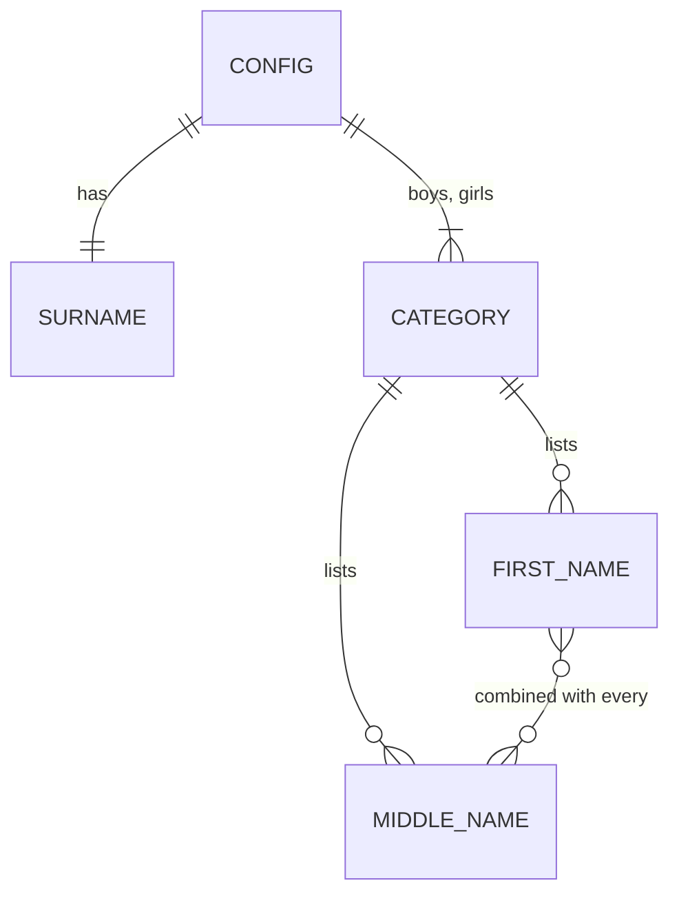

# Data Model: Name Routing

Static, read-only. Defined in `src/data/config.ts`.

## Types

| Type | Fields | Rules |
|---|---|---|
| `CategoryId` | `'boys' \| 'girls'` | Fixed set; anything else is not-found (FR-005) |
| `CategoryConfig` | `first: string[]`, `middle: string[]` | Own lists per category (clarification Q2) |
| `Config` | `surname: string`, `boys`, `girls` | One surname for the whole site (clarification Q1) |
| `FirstName` (derived) | `name`, `slug` | `slug = slugify(name)`; unique within category (FR-010) |
| `Combination` (derived) | `{ first, middle, surname, full }` | `full = "First Middle Surname"` |

## Derivations

- `slugify(name)` → URL-safe lowercase slug.
- `findName(category, slug)` → `FirstName | undefined`.
- `combinations(category, first)` → one `Combination` per middle name in that category; empty array when none (empty state, spec edge case).

## Validation

- Config test: slugs unique per category; no empty strings; surname non-empty.
- Type system: only `'boys' | 'girls'` accepted as category in code.
