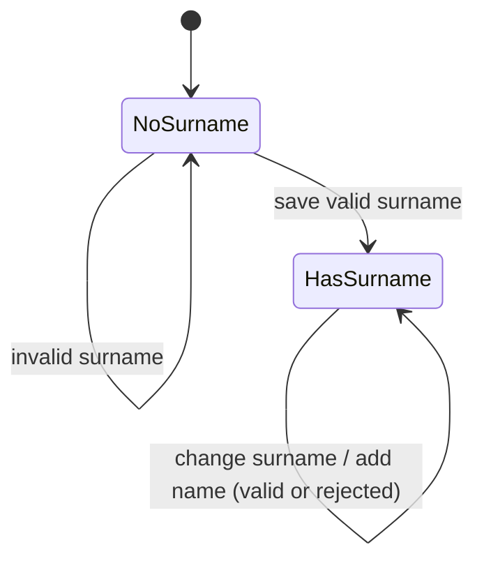

# Data Model: Name Input

> Amended by 004-manage-names: names can now be deleted and promoted/demoted between roles; "First and middle name" is preselected; the built-in config, `merge` and `Names` are gone (the visitor's `Stored` lists are the only data).

## Types

```ts
type Role = 'both' | 'middle'              // "First and middle name" | "Middle name only"
type Added = { first: string[]; middle: string[] }
type Stored = { surname?: string } & Record<CategoryId, Added>   // localStorage JSON, key `baby-names:v1`
type Config = Record<CategoryId, CategoryConfig>                 // built-in names; surname field REMOVED
type Names = { surname?: string; cfg: Config }                   // merged view given to pages
```

`Names.cfg[c].first` = built-in first + added first. `Names.cfg[c].middle` = built-in middle + added middle. Built-in names win; added names are already guaranteed unique by `addName`, but `merge` still dedupes case-insensitively so a hand-edited or stale stored value cannot create duplicates.

## Rules

| Rule | Behaviour | Spec |
|---|---|---|
| `clean(raw)` | trim; error if empty; error if > 50 chars | FR-004 |
| `setSurname(stored, raw)` | returns new `Stored` with the cleaned surname, or an error; overwriting is allowed | FR-001, FR-005 |
| `addName(stored, cfg, category, raw, role)` | error if the name (case-insensitive) is already a first or middle name in that category, built-in or added; for `both` also error if its slug collides with a first name. Else `both` appends to `first` and `middle`; `middle` appends to `middle`. | FR-006–FR-009, FR-011 |
| `combinations(category, first, surname, cfg)` | one per middle name, skipping any middle equal to `first` (case-insensitive) | FR-004 (001), FR-012, FR-015 |
| `merge(cfg, stored)` | builds `Names` | FR-007, FR-008, FR-012 |

Result shape: `Result<T> = { ok: true, value: T } | { ok: false, error: string }`. `clean` returns `Result<string>`; `setSurname` and `addName` return `Result<Stored>`. Errors are user-facing sentences (see [contracts/ui.md](contracts/ui.md)).

## State transitions



Names can only be added in `HasSurname`. Nothing is ever removed (out of scope).

## Store behaviour

- `getSnapshot()`: cached `Stored`; loaded once lazily from storage, then replaced on write.
- `getServerSnapshot()`: same function as `getSnapshot` (client-only app, no real SSR; `renderToString` in tests reads the same store, seeded via `store.save`). With no storage (Node tests) the store is in-memory only.
- `save(stored)`: updates cache, notifies subscribers, tries to persist; returns `persisted: boolean`.
- Corrupt JSON, wrong shape or throwing storage on read: empty `Stored`.
