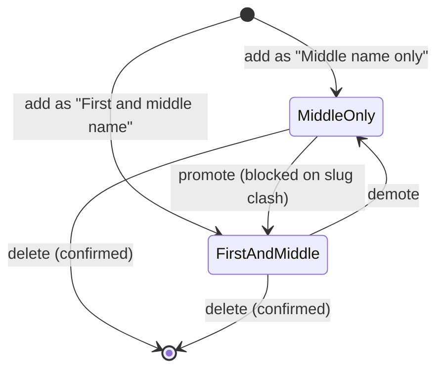

# Data Model: Manage Names

## Types (`src/lib/rules.ts`)

```ts
type CategoryId = 'boys' | 'girls'
type Role = 'both' | 'middle'                       // add form only: "First and middle name" | "Middle name only"
type Lists = { first: string[]; middle: string[] }  // invariant: every first is also in middle
type Stored = { surname?: string } & Record<CategoryId, Lists>   // unchanged shape; key `baby-names:v1`
type Result<T> = { ok: true; value: T } | { ok: false; error: string }
```

`Names`, `Config`, `CategoryConfig` and `merge` are removed. `useNames()` returns `Stored`.

## Roles (derived)

| Role shown | Condition |
|---|---|
| First and middle | name in `first` (and so in `middle`) |
| Middle only | name in `middle` and not in `first` (case-insensitive) |

## Invariants (enforced by `tidy`)

- Within a list: no two names equal ignoring case; sorted by `localeCompare(b, 'en', { sensitivity: 'base' })`.
- Every name in `first` is also in `middle`.
- `tidy` runs on load and as the last step of every writing function.

## Operations (all pure; return a new `Stored`, never mutate)

| Function | Behaviour | Spec |
|---|---|---|
| `tidy(stored)` | dedupe + sort both lists in both categories | FR-002, FR-014 |
| `addName(stored, category, raw, role)` | as 002 (clean, duplicate in either list, slug clash for `both`), result tidied; no built-in config argument | FR-009, FR-011 |
| `removeName(stored, category, name)` | remove from `first` and `middle` (ignoring case) in that category only | FR-005 |
| `demote(stored, category, name)` | remove from `first` only; stays in `middle` | FR-007 |
| `promote(stored, category, name)` | `Result<Stored>`: add to `first`; error on empty slug or slug clash with an existing first name (`{name} clashes with {existing}, which has the same page address.`) | FR-008 |

## Reads (`src/lib/names.ts`, operate on one category's `Lists`)

| Function | Returns |
|---|---|
| `firstNames(lists)` | `{ name, slug }[]` from `first` |
| `middleOnly(lists)` | names in `middle` not in `first` |
| `findName(lists, slug)` | the first name with that slug, if any |
| `combinations(lists, first, surname)` | one per middle name, skipping a middle equal to `first` (002 FR-015), in `middle` order (sorted: FR-014) |

## State transitions per name (within a category)



## Store behaviour

Unchanged from 002 except that `parse` returns `tidy(parsed)`, so older saved data is sorted and deduped on first load. No version bump: the shape is the same. New `persist(next)` wraps `save` and alerts the visitor when it returns `false` (used by delete and move).
