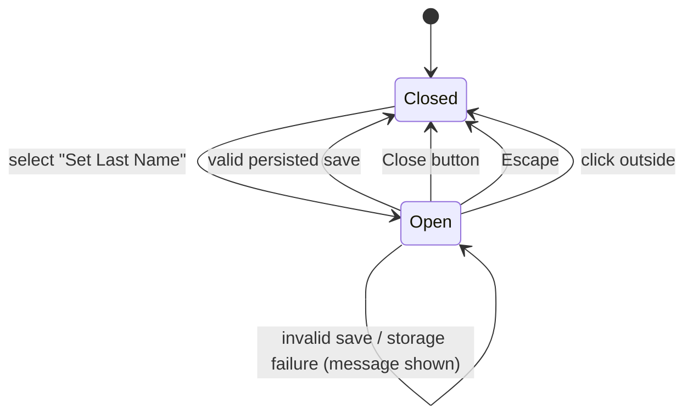

# Data Model: Last Name Modal and Homepage

No data changes. The last name stays `Stored.surname` under key `baby-names:v1`; validation (trim, 1 to 50 characters) and messages are unchanged ([002](../002-name-input/data-model.md)).

## UI state (not persisted)

| State | Owner | Values | Notes |
|---|---|---|---|
| `open` | `App` | `false` / `true` | Set `true` by the header button. Set `false` only by the modal's `onClose`, which fires from the dialog's `close` event. Not in the URL, not in storage, no history entries. |

## Transitions

Each Open → Closed transition goes through `dialog.close()`, which returns focus to the header button.
